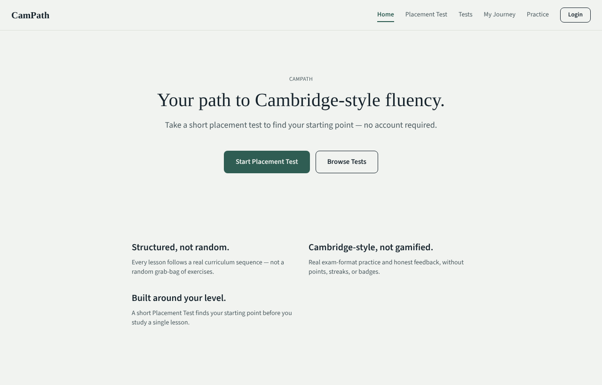
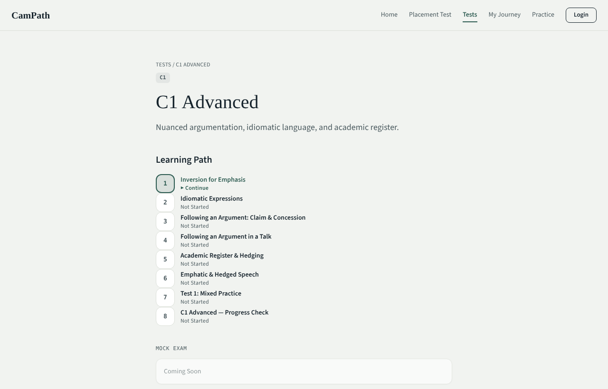
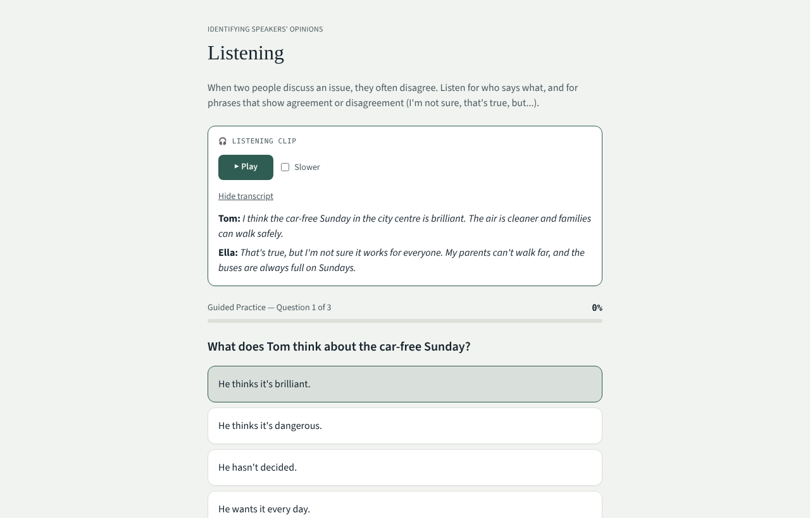
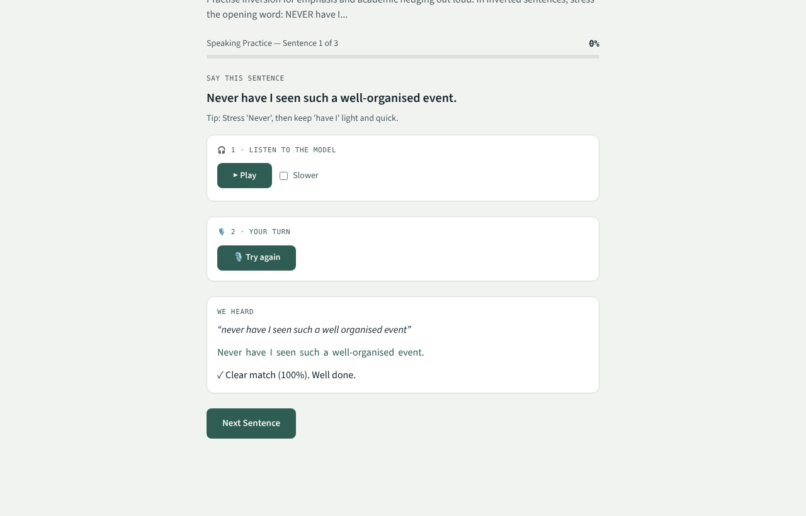

# CamPath

[](https://github.com/aycabosnak/CamPath/actions/workflows/ci.yml) [](LICENSE)

**A full-stack English learning platform for Cambridge-style exam preparation** — placement test, a complete A1–C1 curriculum across six skills, and optional accounts that sync progress across devices.



## Features

- **Placement Test** — 12 mixed-format questions with a 15-minute timer (survives a page refresh), giving a CEFR level, per-skill mastery and a study plan.
- **A1 → C1 curriculum** — six levels, each with Grammar, Vocabulary, Reading, Listening, Writing and Speaking lessons, a Mixed Test and a Progress Check.
- **Listening & Speaking in the browser** — audio generated with the Web Speech API (multi-voice dialogues, slower playback); speaking practice uses speech recognition and highlights the words that weren't recognised.
- **Progress tracking** — My Journey dashboard, mastery by skill, milestones, recommended next step. Nothing is ever locked.
- **Accounts & sync** — optional sign-up; progress made offline on any device is merged into the account.
- **Assessment rules enforced in content** — every test item traces back to a taught lesson, and no test reuses a lesson's reading or listening text ([docs/AssessmentDesign.md](docs/AssessmentDesign.md)).

| Learning path | Listening lesson | Speaking practice |
|---|---|---|
|  |  |  |

## Tech stack

| | |
|---|---|
| **Frontend** | Next.js 14 (App Router) · React 18 · TypeScript · Tailwind CSS · Web Speech API |
| **Backend** | ASP.NET Core 8 Web API (C#) · Entity Framework Core 8 · SQLite · JWT authentication |
| **Testing & tooling** | xUnit integration tests (WebApplicationFactory) · GitHub Actions CI · Swagger / OpenAPI · Docker |

## Architecture

```
Browser (Next.js)                              ASP.NET Core API (backend/)
┌───────────────────────────────┐              ┌──────────────────────────────┐
│ Pages & components            │              │ AuthController   /api/auth   │
│        │                      │   /api/*     │ ProgressController           │
│ services/*  ── localStorage   │ ───────────▶ │   └ ProgressSyncService      │
│ syncService (when signed in)  │  (JWT)       │       (merge rules)          │
└───────────────────────────────┘              │ EF Core ── SQLite            │
                                               └──────────────────────────────┘
```

The app works fully offline and signed-out: every page reads from `localStorage` through a service layer. When the learner signs in, `syncService` sends the whole local state to `PUT /api/progress/sync`; the API merges it with the account using idempotent, order-independent rules (first lesson completion wins, latest test attempt wins, milestones and study days are unions…) and returns the merged state. Any number of devices converge without conflicts. Details: [backend/README.md](backend/README.md).

## Run locally

Requirements: Node.js 20+, .NET 8 SDK.

```bash
# 1. API — http://localhost:5080 (Swagger at /swagger)
cd backend
dotnet run --project src/CamPath.Api

# 2. Web app — http://localhost:3000 (in a second terminal, from the repo root)
npm install
npm run dev
```

The web app runs without the API too; the API adds sign-in and sync. Listening and speaking work best in Chrome or Edge.

## Tests

```bash
cd backend && dotnet test     # 24 integration tests: auth, rate limiting, every sync merge rule
npx tsc --noEmit              # frontend type-check
```

Both run on every push via GitHub Actions.

## Project structure

```
app/            Next.js routes — (public), (auth), (teacher), (internal)
components/     UI library, lesson views, audio player, speaking practice
services/       Business logic: progress, placement scoring, curriculum, auth, sync, speech
lib/mock-data/  Curriculum content: lessons, tests, progress checks, listening scripts
backend/        ASP.NET Core API + xUnit tests (see backend/README.md)
docs/           Architecture, curriculum, assessment design, technical decisions, status
```

## Documentation

- [Project status](docs/PROJECT_STATUS.md) — what's built, known limitations, next steps
- [Architecture](docs/Architecture.md) · [Technical decisions](docs/TechnicalDecisions.md)
- [Curriculum](docs/Curriculum.md) · [Assessment design](docs/AssessmentDesign.md)

## Author

**Ayça Boşnak** — Computer Engineering student, Istanbul Bilgi University · [LinkedIn](https://www.linkedin.com/in/ay%C3%A7a-bo%C5%9Fnak-484124294) · [GitHub](https://github.com/aycabosnak)

## License

[MIT](LICENSE) © 2026 Ayça Boşnak

---

CamPath is an independent learning project and is not affiliated with or endorsed by Cambridge University Press & Assessment.
